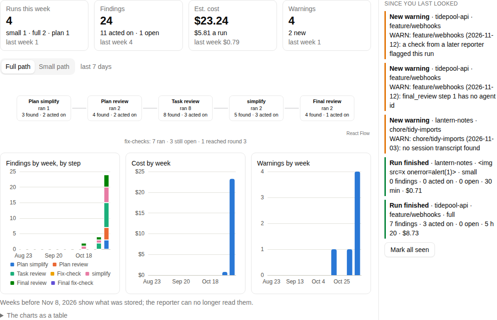

# claude-workflow-dashboard

A live, local dashboard for a Claude Code agentic workflow. It runs the workflow's reporter, `workflow-report.py --json --changed-since <cursor>`, on start, whenever the workflow's run log changes, every 15 minutes when a session transcript changed, and on the page's refresh button, keeps every import in a local SQLite database, and shows what the reporter says: runs by path, the findings each review step raised and acted on, warnings, and estimated spend, week by week.



The screenshot is one of the screenshot-test baselines, on invented data. The repo holds code and invented fixtures only; the real data is read at run time on your own machine and never leaves it. The server listens on `127.0.0.1` only.

## Requirements

- macOS (the dashboard runs as a launchd agent).
- Node 22.18 or later (see `.nvmrc`): Node runs the server's TypeScript directly.
- pnpm, the version in `package.json`'s `packageManager` (for example through `corepack enable`).
- The workflow's reporter installed at `~/.claude/scripts/workflow-report.py`, printing JSON version 1 and accepting CR6's `--changed-since` (a reporter before CR6 rejects it, so every import fails). Without it, each import fails with a banner naming the missing command.

## Install

```sh
pnpm install
pnpm build
pnpm agent:install
```

`pnpm build` builds the web app, which the server serves. `pnpm agent:install` writes a launchd agent to `~/Library/LaunchAgents/com.shoklah.claude-workflow-dashboard.plist` that starts the server at login, with the `node` that ran the command, and keeps it running. The dashboard is then at <http://localhost:4317>.

`pnpm agent:uninstall` stops the agent and deletes its file. To reinstall (after moving the repo or changing Node), uninstall first.

## The data folder

Everything the dashboard stores lives in `~/Library/Application Support/claude-workflow-dashboard/`, created with mode `0700`:

- `dashboard.sqlite`: the imports and what was read from them.
- `logs/`: the agent's `out.log` and `err.log`.
- `.env` (optional): the Anthropic API key and the labeller's settings, as `.env.example` lists them; with no key, the labeller stays off.
- `config.json` (optional): overrides any of the defaults below.

| Key | Default |
|---|---|
| `port` | `4317` |
| `reporterCommand` | `["/usr/bin/python3", "-I", "~/.claude/scripts/workflow-report.py", "--json"]`, with `~` expanded; the dashboard appends `--changed-since <cursor>`, so an override must accept it and must not pass `--since` |
| `runLog` | `~/.claude/workflow-log.jsonl` (an import runs when it changes) |
| `projectsDir` | `~/.claude/projects` (the session transcripts, checked every 15 minutes) |
| `reporterTimeoutMs` | `120000` |
| `aliases` | `{}`: showing mode's display names, by project root path, e.g. `{"/Users/me/Work/app": "Notes app"}` |

## Checking your real data

```sh
pnpm --filter @cwd/server check:real
```

runs the reporter once and says whether the dashboard reads its output: the JSON version, the fields it can't read (`fields: none` when all is well), the run key counts, the reporter's unit keys compared with the app's (`reporter keys: N compared, M differ`, or `not in the export` before CR6; a non-zero M means the key recipes drifted, so an incremental export's removed units would never be marked), and where the pages' sums over every run and session differ from the reporter's totals: the weeks (every field, cost to the cent), the Full run time groups, the step kinds and the rules (`failing_test`, `fix_round_cap`, `stop_rule`, `offers`) by name, the units' sums (`dispatch_guard`, `startup` and the `advisor`'s facts, cost to the cent and share to 0.01 points) by name, and the skills (loads, last load and missing count, a skill required but never loaded included) and models by count only, since a project can name a skill or agent. A total the export lacks (the old reporter's) shows as `not in the export`, and so does the units' line when the export's units predate the dispatch guard, startup and advisor facts. It then imports the output into a fresh database in a temp folder (never the dashboard's own), turns showing mode on for the first project, and checks every API response, the Weeks, Steps and rules, Skills, Models, Compliance and Sessions pages' included, for a hidden project's path, name or branch and for session IDs: `showing: pass`, or `showing: <n> leaks (<m> inside words)` followed by a `showing leak:` line for each route and kind of hidden string, saying whether it is in a key or a value, never the string itself. It prints no value from the data but those weeks' dates.

## Development

```sh
pnpm vitest run                                             # unit, API and Storybook tests
pnpm --filter @cwd/web exec playwright test --project=checks # accessibility and behaviour, on fixtures
pnpm test:screens                                           # screenshot comparisons, in the Playwright container (Docker)
pnpm --filter @cwd/server dev:fixtures                      # the server on invented data
```

CI runs all of these on the invented fixtures.
